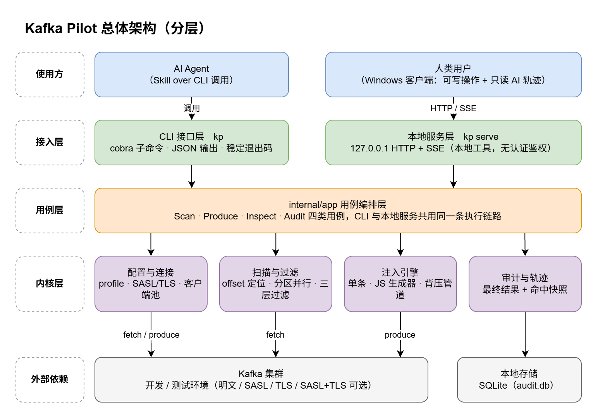
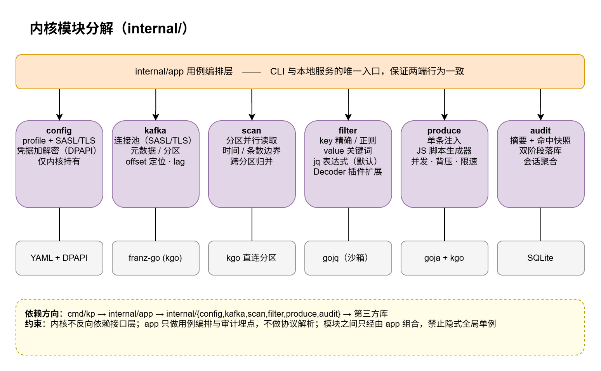
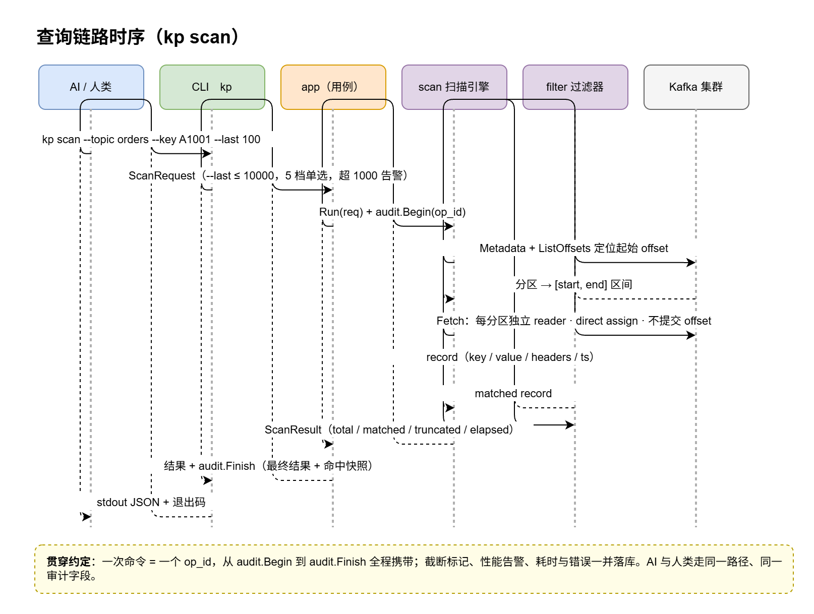
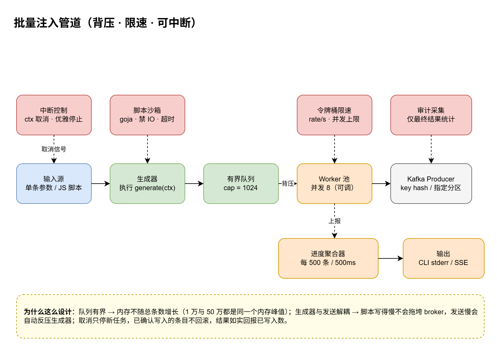
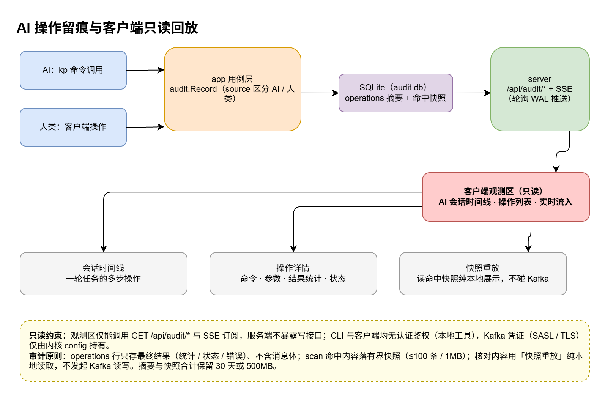

# 总体架构、内核模块与关键流程

> **分册说明**：本文件由 `docs/kafka-pilot-设计文档.md` v1.5 按主题拆分而来，正文与原章节逐行一致（未删改），章节编号沿用原编号，既有 `§x` / `FR-xx` 交叉引用继续有效。
> **收录章节**：原 §七 总体架构设计、§八 内核模块设计、§十二 关键流程、§十四 技术选型
> **索引**：`docs/README.md` · **全局总览**：`docs/kafka-pilot-设计文档.md` · **拆分前完整快照**：`archive/kafka-pilot-设计文档-v1.5-拆分前快照.md`
> **维护纪律**：改动本册须按 `AGENTS.md` §7 同步主设计文档变更记录、`README.md`、`skill/SKILL.md`。

---

## 七、总体架构设计

分层职责：

| 层 | 职责 | 关键约束 |
|---|---|---|
| 使用方 | AI Agent（Skill over CLI）、人类（客户端） | — |
| 接入层 | CLI（cobra，JSON 输出 + 稳定退出码）；本地服务（127.0.0.1 HTTP + SSE，本地工具无认证鉴权） | 接入层不做业务逻辑，只做参数解析 / 渲染，不接触 Kafka 凭证 |
| 用例层 | `internal/app`：Scan / Produce / Inspect / Audit 四类用例 + 审计埋点 | **CLI 与客户端共用同一条执行链路**——这是"同一套内核"的落点 |
| 内核层 | config / kafka / scan / filter / produce / audit / cache 七个模块（cache 为本版新增，FR-15） | 不反向依赖接入层；模块间只经 app 组合；Kafka 凭证仅在 config 模块内解密使用 |
| 外部依赖 | Kafka 集群；本地存储（SQLite） | — |

**为什么这样分层**：用户的核心诉求之一是"除了交互层，底层公用同一套内核"。用例层是唯一入口意味着：AI 走 CLI 得到的结果，与人在客户端点同样的操作得到的结果，来自同一段代码、产出同样的审计记录——双端一致性不靠约定，靠结构保证。

## 八、内核模块设计

| 模块 | 职责 | 关键设计 |
|---|---|---|
| `config` | profile 增删改查；**数据目录解析（`kp-data` 默认 + `kp-settings.yaml` 可配置 + `KP_APPDATA` 覆盖）、一次性迁移与目录切换**（FR-16）；凭据加解密（Windows DPAPI） | 配置文件 YAML；`kp-settings.yaml` 固定放 exe 旁、数据目录可移动；`config.yaml` / audit 三件套整组复制、不覆盖不删除；凭据密文存储，开发环境可选明文并显式标注；**Kafka 凭证只在内核持有，CLI / UI 不感知** |
| `kafka` | 连接池（按 profile 缓存 Client，多 broker 发现、SASL / 单向 TLS 组合按 profile 配置化）、元数据获取、offset 定位、lag 计算 | 基于 franz-go（kgo），纯 Go 无 CGO，原生支持 SASL（PLAIN/SCRAM）与单向 TLS（CA 证书 / 跳过校验） |
| `scan` | 分区并行读取、时间 / 条数边界计算、跨分区归并排序、截断判定 | 每分区独立 reader（direct assign）；归并按 timestamp 倒序；扫描在内存中完成（≤10000 条，v1.2e） |
| `filter` | 三层过滤：key → keyword → 表达式；Decoder 插件接口 | 三层串联短路：前一层数量少时后一层计算量随之减少；gojq 程序预编译、单次扫描复用；内置 text / json 两个 Decoder，json 为默认，预留自定义插件注册 |
| `produce` | 单条注入 + 脚本生成器 + 背压管道 + 限速 | 见第十二章流程 4 |
| `audit` | op / session 摘要与**有界命中快照**入 SQLite（operations 行不含消息体，scan 命中快照独立表存储）、双阶段落库、会话聚合、保留策略清理（含快照） | SQLite 用 modernc.org/sqlite（纯 Go，免 CGO，保持单二进制交叉编译能力） |
| `cache` | 有界物化前缀缓存（FR-15）：`cache_messages` + `cache_meta` 双表，Append/GetRange/EvictBelow/EvictPartition/Clear/SetLimits/enforce，双上限（MaxEntries/MaxBytes）淘汰最旧 offset；复用 modernc.org/sqlite、独立 `cache.db` + WAL | 幂等写入（同 offset 重写为空操作）；Topic ID 重建守卫；`enforce()` 保证不超预算；与 scan 解耦，缓存丢失可随时从 broker 重建 |

**依赖方向约束**：`cmd/kp → internal/app → internal/{config,kafka,scan,filter,produce,audit} → 第三方库`。内核模块禁止反向 import 接入层；app 层不做协议解析只做编排；禁止隐式全局单例（连接池由 config 显式持有）。

---

## 十二、关键流程

### 12.1 查询链路

要点：一次命令 = 一个 op_id 贯穿；ListOffsets 定位（时间窗 → offset 区间，last N → **逐分区** HWM 回推 N 条；v1.3c：命中 ≤ 分区数 × N，各分区结果全部返回，不再全局截断）；每分区独立 reader 并行 fetch；三层过滤串联短路；仅安全上限 / 超时才截断，告警随结果返回并落审计（最终结果 + 命中快照）。

### 12.2 注入管道

要点：有界队列（cap 1024）实现背压——内存占用不随总条数增长（1 万与 50 万条内存峰值相同）；生成与发送解耦，脚本慢不拖垮 broker、发送慢自动反压生成器；取消只停新任务，已确认写入不回滚、如实回报。

### 12.3 审计与只读回放

要点：AI 与人类操作落同一张表、同一套字段，`source` 区分；op 双阶段落库（启动插入 running → 终态更新），serve 轮询 SQLite 并经 SSE 推送观测区实时流入；**operations 行只存最终结果、不含消息体**，scan 命中内容落有界快照（≤100 条 / ≤1MB）——需要核对内容时「快照重放」纯本地读取展示，不发起任何 Kafka 读写；观测区仅有 GET + SSE 只读通道，服务端不暴露写接口。

---

## 十四、技术选型

| 组件 | 选型 | 理由 | 备选 |
|---|---|---|---|
| Kafka 客户端 | franz-go (kgo) | 纯 Go、性能好、direct assign 支持完善、SASL（PLAIN/SCRAM）与单向 TLS 组合支持完善、维护活跃 | sarama（API 老）、confluent-go（CGO 依赖） |
| jq | gojq | 纯 Go、兼容 jq 语法、可预编译 | 内嵌解释器自研（成本高） |
| JS 引擎 | goja | 纯 Go、ES2017+、无进程隔离开销 | 外部 node 子进程（违背单二进制） |
| SQLite | modernc.org/sqlite | 纯 Go 免 CGO，保住单二进制 | mattn/go-sqlite3（需 CGO） |
| CLI | cobra | 事实标准，help / 补全完善 | — |
| 前端 | React + Vite + TS + **Fluent UI React v9** | 官方 Fluent 组件库，原生 Windows 11 观感，embed.FS 打包 | 自建组件库（成本高、观感不统一） |

