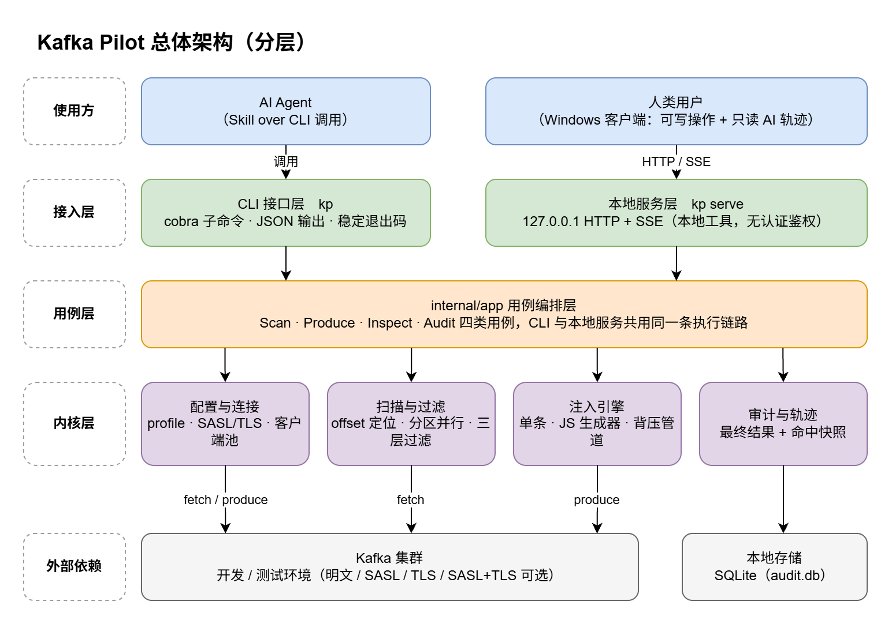
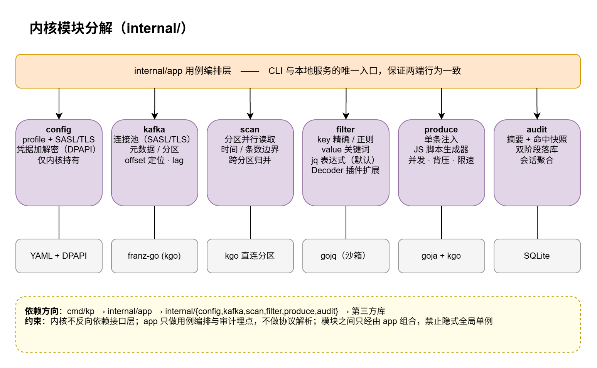
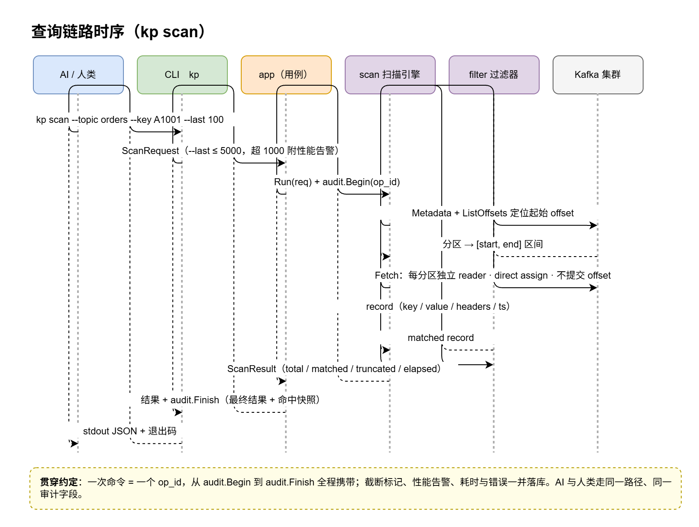
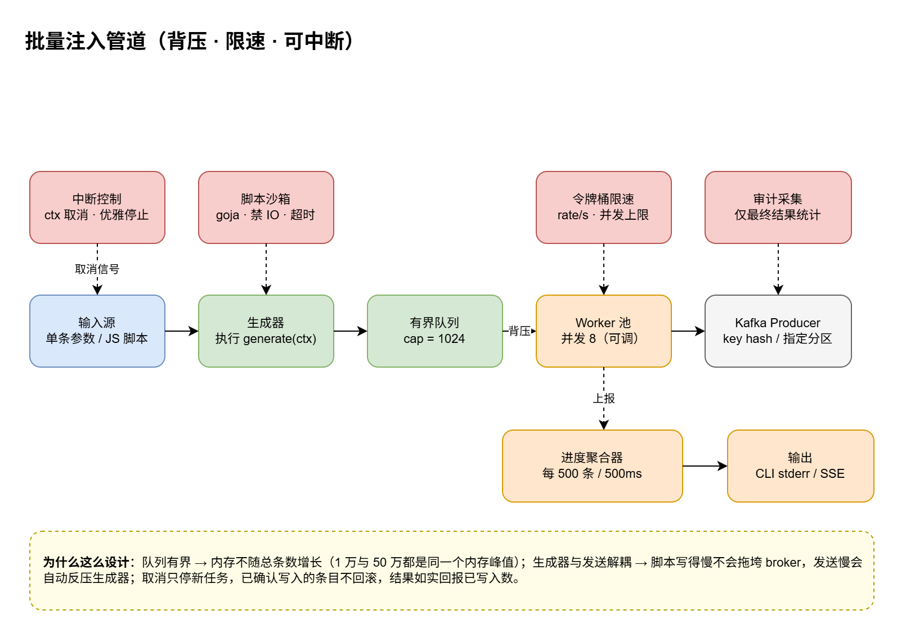
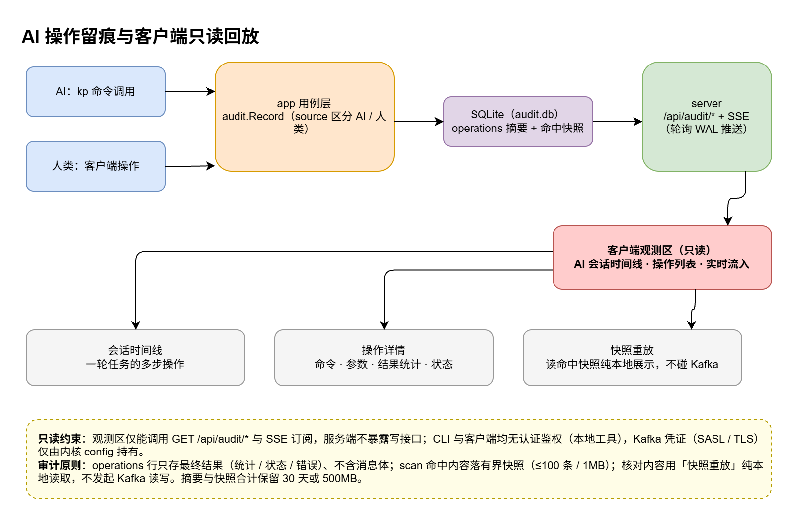

# Kafka Pilot 设计文档

> 面向 AI Agent 与人类双端的 Kafka 数据查看 / 造数工具

## 一、文档信息

| 项 | 内容 |
|---|---|
| 文档版本 | v1.2（第 2 轮评审：连接认证显式化 + 评审决策落地） |
| 作者 | 司南（产品经理 Agent）× 用户共创 |
| 日期 | 2026-11-07 |
| 状态 | 设计评审中 |

**变更记录**

| 版本 | 日期 | 变更 | 备注 |
|---|---|---|---|
| v1.0 | 2026-11-07 | 初稿 | 基于 3 轮需求澄清（13 项决策）产出 |
| v1.1 | 2026-11-07 | 评审反馈修订：① 审计只存最终结果、不落任何消息体；② CLI / 客户端取消认证鉴权，Kafka 凭证仅内核持有；③ session 改为 CLI 随机生成短 ID；④ jq 为默认解码插件并预留扩展接口；⑤ Windows UI 采用 Fluent Design；⑥ 假设 A1~A6 全部确认闭环 | 用户反馈 7 条，全部闭环 |
| v1.1a | 2026-11-07 | 新增 §10.4 界面设计草图（6 页高保真线框，Fluent Design）：`docs/figures/ui-mockups.html` | 补充客户端视觉与布局基线 |
| v1.1b | 2026-11-07 | ① FR-01 Topic 列表信息极简：仅名称 / 分区数 / 各分区最新 offset，去掉 HWM、清理策略、消息总量、时间等其他元数据（UI 草图屏 1 同步修订）；② 新增图表维护约定：架构图经 drawio MCP 生成与维护，读取 / 修改必须走 MCP 并同步更新图片 | 用户反馈 2 条 |
| v1.2 | 2026-11-07 | ① **Kafka 连接认证显式化（用户需求）**：SASL 用户名密码与 TLS 均为可选、互相独立，支持明文 / SASL / TLS / SASL over TLS 四种组合，FR-13 重写为字段级配置（D18）；② 评审四决策落地：`--last` 改回扫量语义并取消 `--limit`（FR-03/05）、dry-run 提前至 v0.3（§16）、重放改为有界命中快照纯本地回放（D7/FR-09/FR-12/图5）、客户端支持完整 profile 管理（FR-11）；③ 矛盾修复：内存口径两档化（§13）、command 字段 2KB 截断（FR-09）、op 双阶段落库 + running 状态 + serve 轮询实时机制（FR-09/12）、审计完整率口径修订（§2.3）；④ 边界补全：topic describe 补 FR（FR-01）、scan 超时 30s（FR-05）、`--partition` 多值与归并 tie-break（FR-03）、二进制 header / 非 UTF-8 key（FR-04）、session 24h 自动结束（FR-10）、SKILL Never do 增补 audit clear（§9.3） | 本轮评审闭环，用户 5 项决策 |
| v1.2a | 2026-11-08 | ① **TLS 收窄为单向**（用户反馈）：移除 mTLS 双向认证，`tls` 仅保留 `ca_cert`（客户端校验服务端）+ `skip_verify`（直接跳过校验），取消 `client_cert` / `client_key` 字段及 `--tls-client-cert` / `--tls-client-key` 参数（FR-13、D18、§13/14 同步）；② **bootstrap_servers 显式支持多 broker 地址**：YAML 数组 / CLI 逗号分隔 / UI 多行输入，kgo 自动发现全集群（FR-13） | 用户反馈 2 条 |

**图表维护约定（重要）**

- 本文档全部架构图 / 流程图 / 时序图（`figures/1~5`，PNG 与多页源文件 `docs/figures/kafka-pilot-架构图.drawio`）均**通过 drawio MCP 工具生成**；
- 任何对图表的**读取或修改必须通过 drawio MCP 进行**（查看图元、编辑页面、增删页），禁止手工编辑 `.drawio` XML 文件或使用其他工具改图；
- 文档中**涉及图表内容的设计变更**（架构、模块、链路、流程等）发生时，必须**调用 drawio MCP 同步修改对应页面并重新导出 PNG**，保证图文一致，不允许图文脱节；
- 界面草图 `docs/figures/ui-mockups.html` 为 HTML 线框，不属 drawio 管辖，可直接编辑文件。

**已确认的关键决策（澄清结论）**

| # | 决策项 | 结论 |
|---|---|---|
| D1 | 内核技术栈 | Go，单二进制，无运行时依赖 |
| D2 | 客户端形态 | 本地 Web UI：内核起 127.0.0.1 HTTP/SSE 服务，前端窗口呈现 |
| D3 | 使用环境 | 开发 / 测试环境自用，弱权限、重效率 |
| D4 | 表达式语法 | jq 风格（gojq 沙箱） |
| D5 | 消息格式 | 纯文本 / JSON，不做 Schema Registry |
| D6 | 注入脚本 | JavaScript 内嵌（goja 沙箱） |
| D7 | 审计粒度 | 调用级摘要 + 最终结果 + 任务会话时间线 + **有界命中快照**（v1.2 修订：不落原始扫描全量消息；scan 命中结果落快照每 op ≤100 条 / ≤1MB，供纯本地重放；produce 不落快照） |
| D8 | 功能边界 | 查数据 + 造数据 + 只读观测（topic 元数据、consumer lag）；不做 topic 增删改 |
| D9 | 扫描边界 | 默认回扫最近 100 条，上限 5000，超 1000 提示性能风险（v1.2 修订：`--last` 为回扫量语义——回扫 N 条原始消息、命中数 ≤ N；`--limit` 取消） |
| D10 | 人类权限 | 客户端可写（与 AI 同能力），AI 轨迹区纯只读 |
| D11 | 连接配置 | 多集群 profile |
| D12 | 注入规模 | 万级（1 万～50 万条），背压流式管道，速率 / 并发可调 |
| D13 | 审计存储 | SQLite 单库存摘要与最终结果，保留 30 天 / 500MB（v1.1 修订：取消 JSONL 原文文件） |
| D14 | 认证鉴权 | CLI 与客户端均不做认证鉴权（本地单机工具定位）；Kafka 连接凭证仅由内核 config 模块持有（v1.1 新增） |
| D15 | 会话标识 | CLI 提供 `kp session new` 随机生成短 session_id（6 位数字+字母）；Agent 先生成、后每条命令显式携带 `--session`（v1.1 新增） |
| D16 | 解码扩展 | jq 为默认解析 / 过滤插件，预留 Decoder 扩展接口供后续自定义插件（v1.1 新增） |
| D17 | UI 设计语言 | Fluent Design（Fluent UI React v9，Mica/Acrylic 材质、跟随系统主题与强调色），现代简洁（v1.1 新增） |
| D18 | 连接认证 | SASL 用户名密码认证与 TLS 均为**可选**、互相独立，支持明文 / SASL / TLS / SASL over TLS 四种组合；TLS 为**单向**（客户端校验服务端，仅 `ca_cert` + `skip_verify`，不支持 mTLS 双向认证）；`bootstrap_servers` 支持配置多个 broker 地址（v1.2 新增，v1.2a 收窄 TLS 为单向 + 显式多 broker） |

## 二、背景与目标

### 2.1 背景

开发测试阶段排查 Kafka 数据问题时，现有方式效率低：`kafka-console-consumer` 参数繁琐、无过滤能力；自写脚本每次重复造轮子；AI Agent（Claude / WorkBuddy 等）无法安全、结构化地访问 Kafka——要么没有入口，要么输出不可控、操作不可追溯。

同时，AI 操作存在信任问题：**AI 到底查了什么、往 topic 里灌了什么，人需要一个只读窗口去核对**。

### 2.2 目标

| 目标 | 衡量口径 |
|---|---|
| 让 AI Agent 一条命令完成 Kafka 查数 / 造数 | 单命令完成，输出为稳定结构的 JSON，无需二次解析处理 |
| 让人类零门槛操作 | 客户端图形界面完成全部查询与注入，无命令行依赖 |
| AI 操作全程留痕、人类可只读回放 | 每次调用产生 op 记录，客户端按会话时间线 100% 还原 |
| 双端行为一致 | CLI 与客户端共用同一内核用例层，功能行为无分叉 |

### 2.3 成功指标（口径）

| 指标 | 口径 | 目标值 |
|---|---|---|
| 查询命中准确率 | 给定 key / 关键词 / 表达式，命中结果与预期一致的比例 | 人工抽检 ≥ 99% |
| 查询响应时间 | 默认 last 100 条查询，从发起至结果返回 | P95 ≤ 3s（局域网集群） |
| 注入吞吐 | 速率参数放开、并发 8 时单机生产 TPS | ≥ 5000 条/s（估算，依赖 broker 配置） |
| 审计完整率 | CLI / 客户端操作被完整记录（含参数与最终结果统计）的比例；崩溃 op 经启动扫描标记 crashed 收敛 | 正常退出路径 100% |
| 审计体积 | 单条 operations 记录平均大小（命中快照独立存储，每 op ≤1MB，不计入本口径） | < 4KB（不含消息体） |
| 双端一致性 | 同一操作 CLI 与客户端产生相同结果与相同审计字段 | 100% |

## 三、名词与术语

| 术语 | 定义 |
|---|---|
| 内核（core） | `internal/` 下的 Go 包集合，承载全部 Kafka 能力，不含任何界面逻辑 |
| 用例层（app） | `internal/app`，将内核模块编排为 Scan / Produce / Inspect / Audit 四类用例，CLI 与本地服务唯一入口 |
| op（操作） | 一次 CLI 调用或一次客户端操作，审计的最小单位，有唯一 op_id |
| session（会话） | AI 一轮任务（如"排查订单丢失"）的聚合单位，包含 1..N 个 op；由 `kp session new` 生成 6 位短 ID |
| 观测区 | 客户端中只读展示 AI 操作轨迹的功能区 |
| 快照（snapshot） | scan 类 op 落盘的有界命中结果：仅命中消息（过滤后，非全量扫描），每 op ≤100 条且序列化 ≤1MB，存 audit.db 独立表，供本地重放（v1.2 新增） |
| 重放（replay） | 读取 scan 类 op 的命中快照做**纯本地展示**，不发起任何 Kafka 读写，用于核对 AI 当时查到的内容（v1.2 修订：由"重新执行查询"改为"读快照"） |
| HWM | High Water Mark，分区最新可见 offset |
| 背压 | 有界队列写满时阻塞上游生成器，防止内存随总条数增长 |
| direct assign | 消费者直接指定分区与 offset 读取，不加入 consumer group、不提交 offset |

## 四、用户角色与核心场景

| 角色 | 入口 | 典型场景 | 能力 |
|---|---|---|---|
| AI Agent | Skill over CLI | 排查"订单消息丢了"；为压测注入 10 万条模拟订单 | 全部命令；每次调用自动留痕 |
| 人类开发者 | Windows 客户端 | 日常查数、造数；检查 AI 刚才干了什么 | 操作区可写 + 观测区只读 |

**核心场景 1：AI 排查消息丢失**
AI 执行 `kp session new` 取得 6 位短 ID → 之后每条命令携带 `--session`：按时间窗 + key 扫描上游 topic → 按 jq 表达式过滤异常记录 → 扫下游 topic 对比 → 输出结论。人类在客户端观测区按会话回放全程，点开任一 op 查看查询参数与最终结果统计，需要看内容时点「重放」实时复现。

**核心场景 2：人类造测试数据**
客户端选择 topic → 注入面板选"脚本"或"模板" → 设置条数 / 并发 / 速率 → dry-run 预览 → 执行并观察实时进度。

**核心场景 3：AI 批量造数**
AI 调 `kp produce --script gen.js --count 100000`，CLI 输出进度行，完成后返回 JSON 汇总；客户端观测区实时显示进度与最终结果统计（成功 / 失败 / TPS）。

## 五、需求范围

**包含**

1. Topic 浏览（名称、分区数、各分区最新 offset）——只读，信息极简，不含清理策略 / HWM 等其他元数据（v1.1b）
2. Consumer Group 列表、成员、分区分配与 lag 观测——只读
3. 消息查询（key / value 关键词 / jq 表达式 / 时间段 / 最近 N 条 / 指定分区）
4. 消息注入（单条 + JS 脚本批量并发）
5. AI 操作审计与会话时间线，客户端只读回放（最终结果 + 有界命中快照，纯本地重放）
6. 多集群 profile 管理（含可选 SASL 用户名密码认证与可选 TLS，v1.2）
7. Skill（SKILL.md）+ CLI 分发

**不包含（本期不做）**

| 项 | 说明 |
|---|---|
| Topic 增删改、分区扩容、配置修改 | 误操作风险高，开发测试环境可用原生工具；记入后续版本池 |
| Schema Registry / Avro / Protobuf 解码 | D5 决策不做；非 JSON 消息按字节 + hex 展示；已预留 Decoder 插件接口（D16） |
| 消息删除 / offset 重置 | 危险写操作，明确不做 |
| 认证鉴权（CLI / UI 层） | 本地单机工具定位，明确不做（D14）；注：此处指**工具自身接口**，Kafka 连接的 SASL / TLS 认证属 FR-13 范围（v1.2 澄清） |
| 跨机器部署 / 多用户 Web 服务 | 单机本地工具定位，服务只绑定 127.0.0.1 |
| 消息生产端埋点采集（业务侧 tracing） | 超出工具边界 |

## 六、核心功能设计

### FR-01 Topic 浏览（v1.1b 修订：信息极简）

- 规则：
  1. topic 列表**仅输出三项信息——topic 名称、分区数、各分区最新 offset**（只读）。不展示清理策略、保留配置、消息总量、最早 offset、时间范围等任何其他元数据。
  2. `kp topic describe <topic>` 输出与列表单项**同构**（name / partitions_count / 逐分区 latest_offset），不引入任何其他元数据（v1.2：补齐该命令的 FR 定义）。
- 验收（GWT）：Given 已配置可用 profile，When 执行 `kp topic list --filter order`，Then 输出名称含 "order" 的 topic 列表 JSON，每项**仅含** `name`、`partitions_count`、`partitions` 数组（每元素为 `partition` + `latest_offset`），无其他字段；When `kp topic describe orders`，Then 输出结构与列表单项一致且不含额外字段。

### FR-02 Consumer Group 观测（只读）

- 规则：列出 group、state、成员与分区分配；按 topic 维度输出各 group 的 committed offset、HWM、lag；lag 超阈值（默认 10000，可配）标记 `highLag=true`。
- 验收：Given group "order-consumer" 订阅 topic "orders" 且 lag=15200，When `kp group lag order-consumer --topic orders`，Then 结果含 `lag:15200` 且 `highLag:true`。

### FR-03 消息查询——定位维度

| 参数 | 语义 | 默认 |
|---|---|---|
| `--partition` | 只扫指定分区，支持逗号分隔多值（如 `0,2`，v1.2）；不指定则扫全部分区并行 | 全部 |
| `--last N` | **回扫量语义（v1.2）**：从各分区尾部回扫 N 条原始消息（跨分区按时间戳倒序归并），三层过滤后命中数 ≤ N | 100 |
| `--since / --until` | 时间窗，按 CreateTime 用 offsetsForTimes 定位起始 offset | 无 |
| `--offset-from / --offset-to` | 精确 offset 区间；未指定 `--partition` 时作用于全部分区（v1.2 澄清） | 无 |

- 规则：
  1. 不指定定位参数时等价 `--last 100`；扫描采用 direct assign，不加入 consumer group、不提交 offset，不影响业务消费。
  2. 参数组合（v1.2 明确）：`--since/--until` 可与 `--last` 组合（时间窗内自窗尾回扫 N 条）；`--offset-from/--offset-to` 与 `--last` 互斥，同时给出报参数错误（exit 2）。
  3. 归并排序 tie-break（v1.2）：timestamp 相同时按 partition、offset 升序。
- 验收：When `kp scan --topic t --since 2026-11-07T10:00:00+08:00 --until 2026-11-07T11:00:00+08:00 --last 100`，Then 在该时间窗内自窗尾回扫 100 条原始消息并返回命中结果，且结果含每分区实际扫描区间。

### FR-04 消息查询——三层过滤

| 层 | 参数 | 语义 |
|---|---|---|
| key 过滤 | `--key`（精确）/ `--key-regex`（正则） | key 序列化为 UTF-8 字符串后匹配；正则用 RE2 语法 |
| value 关键词 | `--keyword` | value 的 UTF-8 文本做子串包含匹配；`--ignore-case` 默认开启 |
| 表达式 | `--expr '<jq>'` | jq 表达式作用于上下文对象 `{key, value, headers, partition, offset, timestamp, size}`；value 为合法 JSON 时自动解析为对象，解析失败退化为字符串；表达式结果为真值即命中 |

- 表达式示例：
  - `.value.orderId == "A1001"`
  - `.value.amount > 100 and .value.status == "FAILED"`（jq 语法）
  - `.headers.traceId != null`
- 安全：gojq 在沙箱内运行，无 IO 能力；表达式编译失败立即返回参数错误（exit 2），不发起扫描。
- 边界（v1.2）：key 为非 UTF-8 字节串时该消息不参与 key 过滤、计为不匹配并在结果 `skippedNonUtf8Key` 计数；header 值为二进制时以 hex 展示；`--ignore-case` 可显式关闭。
- **解码插件扩展点（v1.1 新增）**：value 解码抽象为 `filter.Decoder` 插件接口，内置 `text` 与 `json` 两个实现，`json` 为默认。后续用户可按接口注册自定义解码插件（如 Avro / Protobuf / 自定义报文）：插件只需实现 `Decode([]byte) (any, error)`，表达式上下文结构不变；本期预留接口与注册配置，不实现第三方动态加载。
- 验收：When `--expr '.value.amount > 100'`，Then 仅返回 amount>100 的记录，且每条记录附带原始 offset 供回查。

### FR-05 扫描边界（性能底线）

- 规则：
  1. 单次回扫条数上限 5000（`--last` 为唯一上限参数，v1.2 取消 `--limit`，避免两个上限语义打架；`--last > 5000` 拒绝执行 exit 2）；
  2. 默认 `--last 100`；
  3. 回扫条数 > 1000 时：CLI 输出 `warnings:["scan>1000"]` 并继续；客户端弹确认框；
  4. 单条消息 > 1MB 时 value 截断至 64KB 展示（仅存在于本次响应与命中快照中，不落审计 operations 行；`--output` 写文件属用户显式行为，不受审计约束——v1.2 措辞澄清），标记 `truncated:true`；
  5. 因边界提前终止时，结果标记 `truncated:true` 并附实际扫描区间；
  6. 扫描超时（v1.2 新增）：默认 30s，`--timeout` 可配（1~300s）；超时返回已扫描部分并标记 `truncated:true`，exit 4。
- 验收：When `--last 6000`，Then exit 2，错误信息说明上限 5000；When `--timeout 1` 且集群无响应，Then exit 4 且返回已扫描部分与 `truncated:true`。

### FR-06 单条注入

- 规则：`kp produce --topic t [--key k] --value '...' [--header k=v ...] [--partition n]`；`--value-file` / `--key-file` 支持从文件读取（UTF-8）；value 不合法 JSON 时不做校验直接按字节发送（工具不做格式警察，但输出 `valueParsed:false` 提示）。
- 验收：Given topic "orders" 3 分区，When 指定 `--key A1001`，Then 消息按 key hash 落入固定分区，重复发送分区一致。

### FR-07 脚本批量注入

- 规则：
  1. 脚本为 JavaScript（goja），须导出 `generate(ctx)`，返回消息对象 `{key?, value, headers?, partition?}` 或其数组；返回 `null/undefined` 表示结束；
  2. `ctx` 提供：`index`（从 0 递增）、`time`（当前毫秒时间戳）、`random()`、`uuid()`、`pick(arr)`；
  3. `--count N` 控制总条数（生成器被调用 N 次）；`--concurrency` 默认 8（1~32）；`--rate` 每秒条数上限（0 = 不限速）；以上参数及队列容量、进度上报间隔均支持 profile 默认值 + 命令行覆盖（A1 确认）；
  4. 沙箱：禁 IO（无网络/文件/进程能力），单次脚本执行超时 5s，超时终止并报错；
  5. `--dry-run`：只运行生成器并输出前 5 条样例，不发送。
- 验收：Given 脚本返回 `{value:{orderId:"T"+ctx.index}}`，When `--count 3 --dry-run`，Then 输出 value.orderId 为 T0/T1/T2 的样例且 Kafka 无新消息。

### FR-08 注入进度与中断

- 规则：每 500 条或每 500ms 上报一次进度（CLI 写 stderr 进度行；客户端经 SSE 推送；间隔可配置）；`Ctrl+C` 或客户端"停止"按钮触发 context 取消：停止生成新消息，等待在途批次完成（最长 10s），结果如实回报 `produced`（已确认写入条数）、`failed`、`cancelled:true`。已写入条目不回滚。
- 验收：When `--count 100000` 执行 3s 后 Ctrl+C，Then 输出 `produced` 为实际已确认条数且 `cancelled:true`，进程 10s 内退出。

### FR-09 操作审计（v1.2 修订：最终结果 + 有界命中快照 + 双阶段落库）

- 规则：
  1. 每次 op 记录：op_id、session_id、source（ai/human）、actor（agent 名 / 用户名）、intent（AI 声明的意图，可选）、命令（含完整参数，**>2KB 截断并标记 `commandTruncated:true`**——v1.2 新增，守住单条 <4KB 口径）、started_at / duration_ms、status（**running** / ok / error / truncated / cancelled / **crashed**——v1.2 新增 running 与 crashed）、result_summary、warnings、error；
  2. **双阶段落库（v1.2）**：op 启动即插入 `status=running` 行（含 op_id / session / 完整命令 / started_at），终态在完成 / 失败 / 取消时更新；`kp serve` 启动时将 started_at 超过 10 分钟仍为 running 的 op 标记 `error(crashed)`，硬崩溃不留悬挂记录；
  3. **result_summary 只存最终结果统计**：扫描条数 / 命中条数 / 注入成功数 / 失败数 / TPS / 耗时等数字与状态；produce 进行中经 result_summary 周期性原地更新（每 500 条 / 500ms），承接观测区实时进度（核心场景 3）；
  4. **有界命中快照（v1.2，替代"重新执行式重放"）**：scan 类 op 将**命中消息**（过滤后，非全量扫描）落一份快照——每 op ≤100 条且序列化 ≤1MB，先到为准，超界截断标记 `snapshotTruncated:true`；produce 类 op 不落快照；快照存 audit.db 独立 snapshots 表，计入 30 天 / 500MB 保留池；设置页提供「命中快照留证」开关（默认开，关闭后 scan 不落快照、重放入口置灰）；
  5. 重放 = 读取快照的纯本地展示：**不发起任何 Kafka 读写、不产生新 op**、不污染时间线（审计完整率口径注明"不含重放"）；
  6. `kp audit clear` 一并清理快照。
- 验收：Given AI 执行一次命中 42 条的 scan，When 在观测区点「重放」，Then 展示快照内容且期间未建立任何 Kafka 连接、审计无新增 op；When 查看 `kp audit show <op_id>`，Then operations 行 <4KB 且不含消息体；When `--value` 携带 1MB JSON 执行单条 produce，Then command 字段被截断至 2KB 且 `commandTruncated:true`。

### FR-10 会话管理（v1.1 修订：短 ID 显式携带）

- 规则：
  1. `kp session new [--label <l>]`：随机生成 6 位短 session_id（Crockford Base32，仅数字与无易混字母，如 `K3M9XT`），即生成即生效；32^6 ≈ 10 亿组合，30 天保留窗口内碰撞概率可忽略，写入时校验唯一、冲突自动重生成；
  2. SKILL 要求 Agent 使用能力前先调用 `kp session new`，其后**每条命令显式携带 `--session <id>`**——不依赖环境变量，命令自包含、可追溯；
  3. `kp session end <id>` 关闭会话；会话 24h 无新 op 自动结束并标记 `auto:true`（v1.2，防 AI 遗忘 end 导致会话永远 open）；未携带 `--session` 的命令作为独立 op（session_id 为空，按自身 started_at 参与保留滚动删除——v1.2 澄清）。
- 验收：Given 连续 3 次带 `--session K3M9XT` 的 scan，When `kp audit list --session K3M9XT`，Then 返回 3 条按时间排序的 op。

### FR-11 客户端操作区（人类可写）

- 规则：提供与 CLI 等价的可视化能力：**profile 完整管理（v1.2：新增 / 编辑 / 删除表单，字段含可选 SASL 认证与 TLS 分组，见 FR-13；凭据经内核 config 以 DPAPI 加密持久化，UI 层不落明文——首次使用零终端，对齐 §2.2"无命令行依赖"目标）**、topic 浏览、查询构建器（定位参数 + 三层过滤表单 + 表达式编辑器）、消息详情（含 hex 视图）、注入面板（单条 / 模板 / 脚本编辑器 + dry-run + 进度条 + 停止按钮）；人类操作同样写入审计（source=human）。
- 验收：客户端执行一次关键词查询后，`kp audit list` 能查到对应 op；在 UI 新建含 SASL+TLS 的 profile 后，`kp topic list --profile <新名>` 可用该连接信息成功连接。

### FR-12 客户端观测区（只读，AI 轨迹）

- 规则：仅提供只读接口（GET /api/audit/*、SSE /api/audit/stream）；UI 功能：会话列表 → 会话时间线（多步操作时序）→ op 详情（命令、参数、耗时、状态、**最终结果统计**、重放入口）；运行中的 op 实时流入；无任何写按钮；重放仅对 scan 类 op 开放，**读取命中快照做纯本地展示（GET /api/audit/{op_id}/snapshot），不发起任何 Kafka 读写、不产生新 op**（v1.2 修订）。
- 实时机制（v1.2 明确）：CLI 与 serve 为独立进程，serve 以 500ms 间隔轮询 SQLite（WAL 模式，读不阻塞写）感知新 op、状态迁移与 produce 进度变更，经 SSE 批量推送前端——观测区对 CLI 发起的 op 同样实时可见（含 running 徽标与注入进度，承接核心场景 3）。
- 验收：观测区页面发起的全部 HTTP 请求方法均为 GET；SSE 断开后自动重连且不丢 op（按 op_id 增量补拉）；CLI 发起 op 后 ≤1s 内出现在观测区并带 running 徽标；重放请求不产生新审计记录、期间无 Kafka 连接建立。

### FR-13 Profile 管理（v1.2 修订：连接认证显式化——SASL 与 TLS 独立可选）

- 规则：
  1. `kp profile add/list/use/show/remove`；字段：name、bootstrap_servers、**sasl（可选）**、**tls（可选）**；默认 profile 可设置；CLI `--profile` 覆盖默认值；客户端顶栏下拉切换；
  2. **bootstrap_servers 支持配置多个 broker 地址**：YAML 中为字符串数组（`["broker1:9092", "broker2:9092", "broker3:9092"]`），CLI `--bootstrap-servers` 接受逗号分隔（`broker1:9092,broker2:9092,broker3:9092`）；kgo 用该列表做初始连接发现全集群，至少配置一个可达地址即可；UI 表单为多行输入或逗号分隔文本框；
  3. **用户名密码认证（SASL）与 TLS 均为可选、互相独立**（D18），支持四种组合：

     | 组合 | sasl | tls | 典型场景 |
     |---|---|---|---|
     | 明文 | ✗ | ✗ | 本地开发集群（默认） |
     | SASL 认证 | ✓ | ✗ | 内网测试集群 |
     | TLS 加密 | ✗ | ✓ | 云集群（客户端校验服务端证书） |
     | SASL over TLS | ✓ | ✓ | 传输加密 + 身份认证双开 |

     > v1.2a 收窄：TLS 仅做**单向**——客户端用 CA 证书校验服务端身份，**不支持 mTLS 双向认证**（暂不需要服务端认证客户端证书）。

  4. profile 字段结构（YAML，v1.2a）：

     ```yaml
     name: dev
     bootstrap_servers: ["broker1:9092", "broker2:9092", "broker3:9092"]
     sasl:                      # 可选，缺省 = 不启用用户名密码认证
       mechanism: plain | scram-sha-256 | scram-sha-512
       username: dev-user
       password: <DPAPI 加密存储>
     tls:                       # 可选，缺省 = 不启用 TLS
       ca_cert: <PEM 路径，可选，校验服务端证书；缺省走系统信任链>
       skip_verify: false       # 直接跳过服务端证书校验，默认 false；true 时不校验证书、无需 ca_cert
     ```

     > v1.2a 收窄：`tls` 仅含 `ca_cert` 与 `skip_verify` 两字段——客户端校验服务端身份（单向），不保留 mTLS 客户端证书 / 私钥字段。

  5. CLI 参数（v1.2a）：`kp profile add` 支持 `--sasl-mechanism / --sasl-username / --sasl-password / --tls / --tls-ca / --tls-skip-verify`，均不传即不启用对应能力；`kp profile show` 输出密码外的敏感值脱敏（`****`）；
  6. SASL 密码经 Windows DPAPI 加密存 config.yaml，**只在内核 config 模块内解密使用，CLI / UI 层不感知**（D14 不变；UI 表单提交的凭据直接透传内核，不落明文）；`ca_cert` 为证书文件路径，非敏感数据，明文存储即可；
  7. `tls.skip_verify=true` 时直接跳过服务端证书校验、无需 `ca_cert`，连接结果附 `warnings:["tls-insecure"]`，客户端连接状态黄标提示；
  8. 连接失败错误按层归因（TCP 不通 / SASL 认证失败 / 证书校验失败），exit 3，错误 JSON 的 hint 给出对应排查建议；
  9. kgo 原生支持 SASL（PLAIN / SCRAM-SHA-256/512）与单向 TLS 组合，无额外依赖（§14）。
- 验收（GWT）：
  - Given profile 仅配 bootstrap_servers（多地址，无 sasl / tls），When `kp topic list --profile dev`，Then 以明文方式连接成功（kgo 自动从任一可达地址发现全集群）；
  - Given profile 配置 sasl(plain, 正确用户名密码) + tls(ca_cert)，When `kp topic list --profile secure`，Then 连接成功，输出含 `auth:"sasl+tls"` 且不含密码明文；
  - Given profile 密码错误，When `kp topic list --profile secure`，Then exit 3，message 含"认证失败"且 hint 指向凭证排查；
  - Given `tls.skip_verify=true`（不配 ca_cert），When 连接成功，Then 不校验证书且结果含 `warnings:["tls-insecure"]`。

### FR-14 机器可读命令契约

- 规则：`kp schema` 输出全部命令、参数、输出 JSON 结构、错误码的机器可读描述（JSON），供 SKILL.md 引用与 Agent 自省；`--help` 同样支持 `--format json`。
- 验收：`kp schema` 输出可被 jq 解析且覆盖 §9.1 命令清单**全部命令**（v1.2：口径由"FR-01~10"修正为命令清单全集，含 describe / profile / session / audit / serve）。

## 七、总体架构设计



分层职责：

| 层 | 职责 | 关键约束 |
|---|---|---|
| 使用方 | AI Agent（Skill over CLI）、人类（客户端） | — |
| 接入层 | CLI（cobra，JSON 输出 + 稳定退出码）；本地服务（127.0.0.1 HTTP + SSE，本地工具无认证鉴权） | 接入层不做业务逻辑，只做参数解析 / 渲染，不接触 Kafka 凭证 |
| 用例层 | `internal/app`：Scan / Produce / Inspect / Audit 四类用例 + 审计埋点 | **CLI 与客户端共用同一条执行链路**——这是"同一套内核"的落点 |
| 内核层 | config / kafka / scan / filter / produce / audit 六个模块 | 不反向依赖接入层；模块间只经 app 组合；Kafka 凭证仅在 config 模块内解密使用 |
| 外部依赖 | Kafka 集群；本地存储（SQLite） | — |

**为什么这样分层**：用户的核心诉求之一是"除了交互层，底层公用同一套内核"。用例层是唯一入口意味着：AI 走 CLI 得到的结果，与人在客户端点同样的操作得到的结果，来自同一段代码、产出同样的审计记录——双端一致性不靠约定，靠结构保证。

## 八、内核模块设计



| 模块 | 职责 | 关键设计 |
|---|---|---|
| `config` | profile 增删改查、路径解析（`%APPDATA%/kafka-pilot/`）、凭据加解密（Windows DPAPI） | 配置文件 YAML；凭据密文存储，开发环境可选明文并显式标注；**Kafka 凭证只在内核持有，CLI / UI 不感知** |
| `kafka` | 连接池（按 profile 缓存 Client，多 broker 发现、SASL / 单向 TLS 组合按 profile 配置化）、元数据获取、offset 定位、lag 计算 | 基于 franz-go（kgo），纯 Go 无 CGO，原生支持 SASL（PLAIN/SCRAM）与单向 TLS（CA 证书 / 跳过校验） |
| `scan` | 分区并行读取、时间 / 条数边界计算、跨分区归并排序、截断判定 | 每分区独立 reader（direct assign）；归并按 timestamp 倒序；扫描在内存中完成（≤5000 条） |
| `filter` | 三层过滤：key → keyword → 表达式；Decoder 插件接口 | 三层串联短路：前一层数量少时后一层计算量随之减少；gojq 程序预编译、单次扫描复用；内置 text / json 两个 Decoder，json 为默认，预留自定义插件注册 |
| `produce` | 单条注入 + 脚本生成器 + 背压管道 + 限速 | 见第十二章流程 4 |
| `audit` | op / session 摘要与**有界命中快照**入 SQLite（operations 行不含消息体，scan 命中快照独立表存储）、双阶段落库、会话聚合、保留策略清理（含快照） | SQLite 用 modernc.org/sqlite（纯 Go，免 CGO，保持单二进制交叉编译能力） |

**依赖方向约束**：`cmd/kp → internal/app → internal/{config,kafka,scan,filter,produce,audit} → 第三方库`。内核模块禁止反向 import 接入层；app 层不做协议解析只做编排；禁止隐式全局单例（连接池由 config 显式持有）。

## 九、CLI 与 Skill 设计

### 9.1 命令清单

```
kp profile list|add|use|show|remove
        # add 支持（均可选，v1.2a）：--sasl-mechanism/--sasl-username/--sasl-password
        #                         --tls/--tls-ca/--tls-skip-verify
        #   bootstrap-servers 支持逗号分隔多地址（broker1:9092,broker2:9092）
kp topic list [--filter <kw>]
kp topic describe <topic>
kp group list [--topic <t>]
kp group lag <group> [--topic <t>]

kp scan --topic <t> [--partition <n>[,<n>...]]
        [--last <n>] [--since <ts> --until <ts>]
        [--offset-from <n> --offset-to <n>]
        [--key <k>] [--key-regex <re>] [--keyword <kw>] [--ignore-case]
        [--expr '<jq>'] [--timeout <s>]
        [--format json|table] [--output <file>]    # --limit 已取消（v1.2，--last 即唯一回扫上限）

kp produce --topic <t> [--key <k>] (--value <v> | --value-file <f>) [--header k=v] [--partition <n>]
kp produce --topic <t> --script <gen.js> [--count <n>] [--concurrency <n>] [--rate <n>] [--dry-run]

kp session new [--label <l>] | end <id> | list | show <id>
kp audit list [--session <id>] [--source ai|human] [--since <ts>]
kp audit show <op-id>
kp audit clear [--before <ts>]     # 手动清空审计

kp schema                      # 机器可读命令契约
kp serve [--port <n>]          # 启动本地服务（浏览器访问）
kp desktop                     # 启动服务 + 打开客户端窗口

# 全局参数：--profile <p> · --session <id> · --intent <text> · --format json|table
```

### 9.2 输出契约（面向 AI 的关键设计）

- 默认输出 JSON（单对象；进度场景为 NDJSON 流）；`--format table` 供人类快速查看。
- 查询结果结构固定：

```json
{
  "opId": "op_01H...",
  "topic": "orders",
  "total": 5000,
  "matched": 42,
  "truncated": false,
  "warnings": ["scan>1000"],
  "elapsedMs": 1830,
  "messages": [
    {"partition": 2, "offset": 88121, "timestamp": "2026-11-07T10:23:11.320+08:00",
     "key": "A1001", "value": {...}, "headers": {"traceId": "..."}}
  ]
}
```

- 退出码：`0` 成功；`2` 参数 / 校验错误；`3` 集群连接失败；`4` 超时或被中断（仍输出部分结果，body 内 `truncated/cancelled` 标记）；`5` 内部错误。错误 JSON 含 `code`、`message`、`hint`（给 AI 的修正建议）。

### 9.3 SKILL.md 要点

| 部分 | 内容 |
|---|---|
| 触发条件 | 用户提到 Kafka 查数据 / 造数据 / 看积压 / 排查消息丢失 |
| Always do | 任务开始先 `kp session new` 取 6 位短 ID，其后**每条命令携带 `--session`**；查询先窄后宽（先 last 100 再扩大）；每次写明 `--intent` |
| Ask first | 注入条数 > 1000 时先向用户确认 |
| Never do | 不得对生产 profile 执行 produce；不得尝试 topic 增删改（工具未提供）；不得绕过回扫上限（`--last ≤ 5000`）；**不得执行 `kp audit clear`（防抹除操作痕迹，v1.2 增补）** |
| Playbook | 排查消息丢失（时间窗 + key 对比上下游）；压测造数（脚本模板 + dry-run → 正式执行） |
| 错误恢复 | exit 2 → 按 hint 修正参数重试；exit 3 → 检查 profile / 网络并告知用户 |

## 十、Windows 客户端设计

### 10.1 形态

`kp desktop` 启动本地服务（127.0.0.1 随机端口；本地单机工具，**不做认证鉴权**）→ 以 WebView2 窗口（Windows 10/11 系统自带）或默认浏览器打开。前端为 React + TypeScript 静态资源，`embed.FS` 打进同一个二进制——**分发物始终只有一个 kp.exe**。

**设计语言：Fluent Design（v1.1 新增）**

| 维度 | 规格 |
|---|---|
| 组件库 | Microsoft 官方 Fluent UI React v9（@fluentui/react-components），原生贴合 Windows 11 观感 |
| 材质 | 标题区 / 侧边导航应用 Mica / Acrylic 材质，内容区保持纯色，避免全屏毛玻璃影响数据可读性 |
| 几何 | 4px 控件圆角、8pt 网格间距、卡片式信息分区 |
| 色彩 | 跟随系统亮 / 暗主题 + Windows 系统强调色；highLag / 失败 / 截断用 Fluent 语义色（红 / 橙 / 灰），状态一眼可辨 |
| 布局原则 | 简洁至上：每页一个主任务，单层侧边导航，列表 + 详情双栏结构，无装饰性元素 |
| 控件 | CommandBar（批量操作）、DataGrid（消息列表，虚拟滚动支撑 5000 条）、Dialog（>1000 条确认）、ProgressRing + Bar（注入进度）、Breadcrumb（topic 层级） |
| 动效 | 克制：页面切换 / 展开收起 150~250ms，注入进度用连续动画，不添加无关特效 |
| 密度 | 紧凑 / 舒适两档可切；消息列表默认紧凑密度 |

### 10.2 信息架构

```
顶栏：profile 下拉 · 连接状态指示 · 服务端口
侧边导航（Acrylic 材质，Fluent 图标）：
├── Topics（列表：名称 / 分区数 / 分区最新 offset，v1.1b 信息极简）
├── 消息查询（查询构建器 + 结果列表 + 消息详情含 hex）
├── 数据注入（单条 / 脚本 / dry-run / 进度条 / 停止）
├── Consumer Groups（列表 / lag 排行 / highLag 高亮）
├── AI 观测区（只读：会话 → 时间线 → op 详情 + 最终结果统计 + 快照重放）
└── 设置（profile 管理（含 SASL / TLS 表单，v1.2）/ 保留策略 / lag 阈值 / 注入默认参数 / 命中快照留证开关）
```

### 10.3 关键交互

| 场景 | 交互 |
|---|---|
| 查询 > 1000 条 | Fluent Dialog 确认框说明性能风险，确认后执行；取消则回落 1000 |
| 表达式编辑 | 输入即本地预编译校验，语法错误即时红字提示（不发请求） |
| 批量注入 | 必须先 dry-run 看样例 → 设置并发 / 速率 → 执行 → 进度条 + 实时 TPS → 完成显示成功 / 失败分布 |
| AI 观测区 | 运行中 op 有"进行中"徽标（serve 轮询 SQLite + SSE 推送，≤1s 延迟）；op 详情展示最终结果统计；scan 类 op 提供「快照重放」按钮，读取命中快照纯本地展示，不发起任何 Kafka 读写（v1.2） |
| 空状态 | 未配置 profile 时全站引导页；查询无结果给"扩大范围"建议按钮 |

### 10.4 界面设计草图（v1.1a 新增）

高保真线框（静态 HTML，含设计标注）：**`docs/figures/ui-mockups.html`**，覆盖 6 个页面：

| # | 页面 | 草图要点 |
|---|---|---|
| 1 | Topics | 列表 + 详情双栏，信息极简：仅名称 / 分区数 / 分区最新 offset；右侧展开逐分区最新 offset；lag 观测收敛至 Consumer Groups 页（v1.1b） |
| 2 | 消息查询 | 查询构建器（定位维度 + 三层过滤，jq 即输即校验）→ 统计条（扫描/命中/耗时/截断）→ 结果表 + 行展开（JSON/Hex 双视图）；含 >1000 条 Fluent Dialog 确认示例 |
| 3 | 数据注入 | 单条 / 脚本批量选项卡；脚本编辑器（goja）+ 参数卡（并发/队列/速率）+ 背压管道进度（TPS/已发送/错误，暂停与中止） |
| 4 | Consumer Groups | 只读 lag 排行 + 分区级明细联动，无 offset 重置入口 |
| 5 | AI 操作审计（浅色） | 三栏：会话（短 ID + 来源徽标）→ 时间线（状态色 + 最终结果统计 + 运行中 SSE）→ op 详情（含「快照重放」，读取本地快照纯展示） |
| 6 | 设置（深色） | profile 管理（含可选 SASL 认证 / TLS 分组表单，v1.2）/ 注入默认参数 / 审计保留 / 命中快照留证开关 / 外观（跟随系统主题、强调色、密度） |

草图顶部附 Fluent 设计令牌（色彩 / 圆角 / 字阶 / 材质），紫色圆点为设计标注并配图例；实现以 Fluent UI React v9 组件为准。

## 十一、数据与存储设计

### 11.1 存储布局

```
%APPDATA%/kafka-pilot/
├── config.yaml          # profiles（凭据 DPAPI 加密）
├── audit.db             # SQLite（WAL 模式，存审计摘要、最终结果与 scan 命中快照；operations 行不含消息体）
└── logs/                # 内核结构化日志（排障用，非审计）
```

### 11.2 核心表

**operations**

| 字段 | 类型 | 说明 |
|---|---|---|
| op_id | TEXT PK | `op_` + ULID |
| session_id | TEXT NULL | 所属会话（6 位短 ID） |
| source | TEXT | ai / human |
| actor | TEXT | agent 名或用户名 |
| intent | TEXT NULL | AI 声明的意图 |
| command | TEXT | 完整命令（含参数；>2KB 截断并标记 `commandTruncated:true`，v1.2） |
| started_at | INTEGER | unix ms |
| duration_ms | INTEGER | |
| status | TEXT | running / ok / error / truncated / cancelled / crashed（v1.2：双阶段落库新增 running，崩溃收敛新增 crashed） |
| result_summary | TEXT(JSON) | **仅最终结果统计**：扫描数 / 命中数 / 注入成功 / 失败 / TPS 等 |
| warnings | TEXT(JSON) | |
| error | TEXT NULL | code + message |

> v1.2 约束：operations 行不含任何消息体，单条 < 4KB（command 截断保底）；原 payload_ref 字段取消；命中消息存独立 snapshots 表。

**sessions**：session_id PK（6 位短 ID）、label、started_at、ended_at、op_count、auto（24h 自动结束时为 true，v1.2）。

**snapshots**（v1.2 新增）：op_id PK、session_id、created_at、messages（JSON，命中消息，单 op 序列化 ≤1MB）、truncated（超 100 条 / 1MB 截断时为 true）；随 operations 同批次滚动清理。

**索引**：`operations(session_id, started_at)`、`operations(source, started_at)`。

### 11.3 保留策略

- SQLite 摘要与命中快照：合计保留 30 天或总量 500MB，超限滚动删除最旧 session 及其 op（含快照）；无 session 的独立 op 按自身 started_at 参与滚动删除（v1.2 澄清）；每日清理任务，`kp serve` 启动时触发；
- **operations 行不落任何消息体**；scan 命中内容以有界快照（≤100 条 / ≤1MB / op）落 snapshots 表；内容核对走「快照重放」（FR-09）；
- 手动清理：`kp audit clear`（可按时间截点，一并清理快照）。

## 十二、关键流程

### 12.1 查询链路



要点：一次命令 = 一个 op_id 贯穿；ListOffsets 定位（时间窗 → offset 区间，last N → HWM 回推，回扫量语义命中 ≤ N）；每分区独立 reader 并行 fetch；三层过滤串联短路；截断与告警随结果返回并落审计（最终结果 + 命中快照）。

### 12.2 注入管道



要点：有界队列（cap 1024）实现背压——内存占用不随总条数增长（1 万与 50 万条内存峰值相同）；生成与发送解耦，脚本慢不拖垮 broker、发送慢自动反压生成器；取消只停新任务，已确认写入不回滚、如实回报。

### 12.3 审计与只读回放



要点：AI 与人类操作落同一张表、同一套字段，`source` 区分；op 双阶段落库（启动插入 running → 终态更新），serve 轮询 SQLite 并经 SSE 推送观测区实时流入；**operations 行只存最终结果、不含消息体**，scan 命中内容落有界快照（≤100 条 / ≤1MB）——需要核对内容时「快照重放」纯本地读取展示，不发起任何 Kafka 读写；观测区仅有 GET + SSE 只读通道，服务端不暴露写接口。

## 十三、非功能设计

| 类别 | 要求 |
|---|---|
| 性能 | 默认查询 P95 ≤ 3s；注入 ≥ 5000 TPS（并发 8、不限速，估算值）；扫描内存两档口径（v1.2 修订，替代自相矛盾的单一 100MB）：默认场景（--last 100）≤ 50MB，最坏情形（5000 条 × 64KB 截断值 + 元数据）≤ 400MB【待实测校准】 |
| 安全 | 服务只绑定 127.0.0.1；CLI 与 UI 无认证鉴权（本地单机工具定位，D14 确认）；Kafka 凭证（SASL 密码）DPAPI 加密且仅内核 config 持有，show / 日志 / 审计全程脱敏；ca_cert 为文件路径、非敏感明文存储；gojq / goja 双沙箱均无 IO；CLI 硬拒绝 `--last` > 5000；`tls.skip_verify` 开启时连接结果显式告警 |
| 兼容 | Windows 10/11 x64（WebView2 系统自带）；Kafka 2.x / 3.x（kgo 兼容）；连接安全：明文 / SASL（PLAIN、SCRAM-SHA-256/512）/ 单向 TLS（CA 证书校验服务端 / 可跳过校验）/ SASL over TLS 四种组合可选（FR-13、D18） |
| 可观测 | 内核 slog 结构化日志写 `%APPDATA%/kafka-pilot/logs/`，与审计分离（日志是排障用，审计是追溯用） |
| UI 设计 | Fluent Design（D17）：Fluent UI React v9、跟随系统主题与强调色、8pt 网格、动效克制 |
| 可访问性 | 客户端关键操作键盘可达，亮暗主题下文字对比度均 ≥ 4.5:1 |

## 十四、技术选型

| 组件 | 选型 | 理由 | 备选 |
|---|---|---|---|
| Kafka 客户端 | franz-go (kgo) | 纯 Go、性能好、direct assign 支持完善、SASL（PLAIN/SCRAM）与单向 TLS 组合支持完善、维护活跃 | sarama（API 老）、confluent-go（CGO 依赖） |
| jq | gojq | 纯 Go、兼容 jq 语法、可预编译 | 内嵌解释器自研（成本高） |
| JS 引擎 | goja | 纯 Go、ES2017+、无进程隔离开销 | 外部 node 子进程（违背单二进制） |
| SQLite | modernc.org/sqlite | 纯 Go 免 CGO，保住单二进制 | mattn/go-sqlite3（需 CGO） |
| CLI | cobra | 事实标准，help / 补全完善 | — |
| 前端 | React + Vite + TS + **Fluent UI React v9** | 官方 Fluent 组件库，原生 Windows 11 观感，embed.FS 打包 | 自建组件库（成本高、观感不统一） |

## 十五、风险与遗留问题

| 编号 | 风险 | 类别 | 概率 | 影响 | 等级 | 应对 |
|---|---|---|---|---|---|---|
| RK-01 | 大消息（接近 1MB）扫描时内存压力大 | 技术 | 3 | 3 | 9 中 | 64KB 截断（仅响应与快照内）；内存口径两档（§13）上线前用 1MB 消息实测校准 |
| RK-02 | goja 与 Node 行为差异导致脚本结果偏差 | 技术 | 3 | 2 | 6 低 | SKILL.md 注明支持的语法子集；dry-run 必走 |
| RK-03 | LogAppendTime 与 CreateTime 混用导致时间窗查询偏差 | 数据 | 3 | 3 | 9 中 | 结果返回每分区实际扫描区间，供用户核对；文档注明按 CreateTime |
| RK-04 | key hash 分区在 broker 端 partitioner 与 kgo 不一致 | 技术 | 2 | 3 | 6 低 | 提供 `--partition` 显式指定兜底；文档说明默认分区语义 |
| RK-05 | 审计与命中快照含敏感信息（查询参数 / 命中消息内容落盘） | 合规 | 3 | 3 | 9 中（v1.2 升级） | operations 行不落消息体 + command 截断 2KB；快照有界（≤100 条 / 1MB）并计入保留滚动清理；设置页「命中快照留证」开关可整体关闭；`kp audit clear` 手动清空（含快照） |
| RK-06 | WebView2 在精简版 Windows 缺失 | 兼容 | 2 | 2 | 4 低 | 自动回落默认浏览器打开 |
| RK-07 | 扫描仅支持 JSON 过滤，Avro 消息只能 hex 查看 | 需求 | 3 | 2 | 6 低 | 已预留 Decoder 插件接口（D16）；后续按需实现 Schema Registry 插件（触发条件：团队引入 Avro） |
| RK-08 | serve 轮询 SQLite 感知 CLI 跨进程 op 的实时链路依赖 WAL 与轮询频率 | 技术 | 2 | 2 | 4 低 | 500ms 轻量查询（WAL 读不阻塞写）+ SSE 批量推送；实测校准端到端延迟 ≤1s（v1.2 新增） |

## 十六、版本规划

| 版本 | 范围 | 交付物 |
|---|---|---|
| v0.1 | CLI 骨架 + profile + topic 浏览 + scan（last / key / keyword）+ 单条注入 + 审计摘要 | kp.exe（CLI 可用） |
| v0.2 | jq 表达式 + 时间段查询 + session 短 ID（session new / --session）+ kp schema | AI 基本可用 |
| v0.3 | JS 脚本批量注入 + 背压管道 + 限速 + 进度 / 中断 + **dry-run（v1.2 提前：安全特性与批量注入同版，SKILL playbook 自 v0.3 起可完整执行）** | 造数能力完整 |
| v0.4 | Web UI 操作区（Fluent Design：查询构建器 + 注入面板 + **profile 完整管理含 SASL / TLS 表单**） | 人类操作界面 |
| v0.5 | AI 观测区（时间线 + SSE 实时 + **快照重放**）+ group lag 观测 | 完整闭环，对齐本设计文档全部 FR |

**MVP 定义**：v0.1 + v0.2 + v0.3 = 最小价值闭环（AI 能查、能造、有留痕）。观测区（v0.5）建议提前与 v0.4 并行，因为"人看得到 AI 干了什么"是本工具区别于普通 CLI 的核心价值。

## 十七、需求追踪矩阵（RTM）

| 需求 | PRD 章节 | 设计落点 | 图 | 验收 |
|---|---|---|---|---|
| 查看数据（key/关键词/表达式/条数/时间段） | §6 FR-03~05 | scan + filter 模块 | 图3 | §6 GWT |
| 测试注入（单条 / 脚本并发） | §6 FR-06~08 | produce 模块 | 图4 | §6 GWT |
| AI 操作留痕（最终结果 + 有界命中快照）+ 客户端只读回放（快照重放） | §6 FR-09~10、FR-12 | audit 模块 + 观测区 | 图5 | §6 GWT |
| 双端同一内核 | §2.2、§7 | 用例层唯一入口 | 图1 | 成功指标"双端一致性" |
| Skill over CLI | §9 | SKILL.md + 输出契约 | — | FR-14 |
| Kafka 连接可选认证（SASL / TLS 四组合） | §6 FR-13 | config + kafka 模块 | — | §6 GWT |
| Fluent Design 界面 | §10 | Fluent UI React v9 + §13 UI 设计 | — | §10 设计规格 |

## 十八、假设确认结果（v1.1 全部闭环）

| # | 原假设 | v1.1 确认结果 |
|---|---|---|
| A1 | 注入默认并发 8、队列 1024、限速 0（不限） | ✅ 确认；并发 / 队列 / 速率 / 进度间隔全部支持 profile 默认值 + 命令行覆盖（FR-07/08） |
| A2 | 审计保留 30 天 / 500MB | ✅ 确认，设置页可改 |
| A3 | lag 高阈值 10000 | ✅ 确认，可配置 |
| A4 | session 依赖环境变量 KP_SESSION_ID | ✅ 已按反馈修订：`kp session new` 随机生成 6 位短 ID（数字+字母），Agent 先生成、后每条命令显式携带 `--session`，命令尽可能短（FR-10、D15） |
| A5 | 消息时间统一取 Kafka 消息时间戳（CreateTime） | ✅ 确认 |
| A6 | value 非 JSON 时表达式过滤退化 | ✅ 确认；jq 为默认解析插件，预留 `filter.Decoder` 扩展接口，后续支持用户自定义插件（FR-04、D16） |

**v1.1 附加确认的两条硬约束**：① 审计只含最终结果、不落任何消息体（FR-09、D7；**v1.2 修订**：scan 落有界命中快照、produce 不落，operations 行仍不含消息体）；② CLI 与 UI 无认证鉴权、Kafka 凭证仅内核持有（FR-13、D14）。

**v1.2 评审新增决策**：① `--last` 为回扫量语义（回扫 N 条原始消息、命中 ≤ N），`--limit` 取消；② dry-run 提前至 v0.3；③ 重放 = 有界命中快照 + 纯本地回放，不发起任何 Kafka 读写；④ 客户端支持完整 profile 管理（含认证表单）；⑤ Kafka 连接认证显式化——SASL 用户名密码与 TLS 独立可选、四种组合（D18）。

**v1.2a 收窄（用户反馈 2 条）**：① TLS 收窄为**单向**——客户端用 CA 证书校验服务端身份或直接 `skip_verify` 跳过校验，移除 mTLS 双向认证（`client_cert` / `client_key` 字段及 `--tls-client-cert` / `--tls-client-key` 参数取消）；② `bootstrap_servers` 显式支持配置多个 broker 地址（YAML 数组 / CLI 逗号分隔 / kgo 自动发现全集群）。

---

*本方案为产品设计参考，具体实施请结合公司合规与法务要求确认。*
